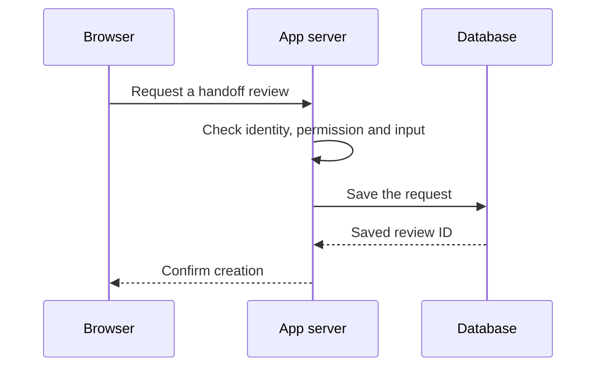

# Follow one click through an API

Builder Academy companion · Beginner first, with optional deeper practice · Fictional alert handoff app

## First pass: what happens when you click Submit?

A SOC manager enters “Review overnight alert escalations” and clicks **Submit**. The browser sends the form to the app server. The server checks the request, saves it if allowed, and replies. The browser uses that reply to show a confirmation or explain what to do next.



**Pause and explain.** Where does the unsent form text live? Which part decides whether the review can be saved? The browser holds the form text. The server decides whether to save the request and uses the database to store it. The API defines what the browser sends and how the server responds.

## Second pass: read the request and response

Here are the relevant lines from a simplified fictional HTTP exchange. Connection and credential details are omitted.

```http
POST /api/review-requests
Content-Type: application/json

{"summary":"Review overnight alert escalations"}
```

- **Method** identifies the requested operation. Here, `POST` submits a request for the server to create a review.
- **Path** identifies the target. `/api/review-requests` is the route this app exposes.
- **Headers** carry information about the exchange. `Content-Type` says how the body is formatted.
- **Body** contains the information sent to the server. In this example it is JSON.

```http
HTTP/1.1 201 Created
Content-Type: application/json

{"id":"review-demo-42"}
```

The **status code** reports the result of the request. The **response body** gives the frontend the new review ID. A separate `GET /api/review-requests/review-demo-42` could retrieve it when the caller has permission.

### Read a network trace

Use the fictional exchange above as your practice trace. Write down its method, path, submitted field, status, and returned ID. Then say what confirmation the frontend could show. If you have an authorized practice environment with a synthetic form, open browser DevTools → **Network** before clicking Submit. Select the request. Look in **Headers**, **Payload**, and **Response** for the same evidence. Use the written trace if the exercise is unavailable. Keep credentials and private request data out of screenshots and notes.

## Third pass: work out where the request stopped

| What you observe | What it tells you in this app | What to check next |
| --- | --- | --- |
| `201 Created` with a review ID | The server reports that it created a review. | Confirm the ID appears in the UI and you can retrieve the record if authorized. |
| `400 Bad Request` and “Summary is required” | The server rejected this input. | Keep the draft, explain which field to correct, then submit the corrected input. |
| `401 Unauthorized` | The request lacks valid authentication credentials. | Check sign-in or credential state and preserve the draft where appropriate. |
| `403 Forbidden` | The server refuses the operation. In this example the caller is signed in but lacks permission for that team. | Check team membership or access policy. |
| No response arrives before the browser gives up | The browser cannot tell whether the server saved the review. | Check for the earlier submission or use the same request key if the API supports that behavior. |

Identity, permission, and input are three separate checks. The server answers each. The frontend can help the user recover by keeping their draft and showing the action appropriate to the failure.

## Fourth pass: call the same API through an SDK

```ts
// Fictional client library call. Read the API contract before using real SDKs.
const review = await reviews.create({ summary: "Review overnight alert escalations" })
```

A **client library** wraps calls your code makes to a service. An **SDK** is a toolkit that may include that client library, examples, and development tools. In this example the library builds the POST request, sends it, and returns the parsed response. The server still checks permissions and saves the record. Your app still owns how it handles an error or an uncertain result. Check the SDK’s documented retry behavior before relying on it.

## Fifth pass: retry without creating two reviews

Imagine the server saved `review-demo-42` and the response was lost. To make a retry safe in this fictional API, the client generates a **request key** for the logical submission and sends it with the first attempt. On a retry of the same submission, it sends the same key and payload. The server scopes that key to the caller and operation, handles concurrent repeats as one operation, and can return the existing result. If the payload changes, the caller needs a new logical submission. This behavior requires an explicit API contract and server implementation. A key in a header alone provides no duplicate protection.

**Practice.** Sketch the form’s three states for this case: submitting, uncertain result, confirmed. Describe how you would test a lost response by letting the server save once, withholding its confirmation, then retrying with the same key and verifying one record exists.

## Check your reasoning

1. **The browser displays “Request timed out” and retains your draft. Did the server save it?** The result is unknown. The browser kept its local draft and missed the confirmation. Check the submission status or use the API’s documented safe retry behavior.
2. **An SDK returns a permission error. Which part should change?** Inspect the caller’s permissions and target team first. Changing the method of calling the API leaves the server’s authorization decision in place.

**Transfer.** Apply the same flow to a fictional expense approval request. Name the endpoint, expected result, one permission check, what the user should see after a timeout, and the evidence that a retry produced one record.

**Continue** with [From source code to running software](source-to-running-software.md) for builds and deployment. After you can explain one request and response, explore [MCP versus REST APIs](mcp-vs-rest-api.md) and [Systems design and architecture choices](systems-design-tradeoffs.md). Polling, webhooks, background jobs, and API versioning are follow-on topics once you have the request model.

[HTTP Semantics](https://www.rfc-editor.org/rfc/rfc9110.html) · [Chrome DevTools Network reference](https://developer.chrome.com/docs/devtools/network/reference/) · [Stripe idempotent requests, one example of a provider-specific retry contract](https://docs.stripe.com/api/idempotent_requests)
