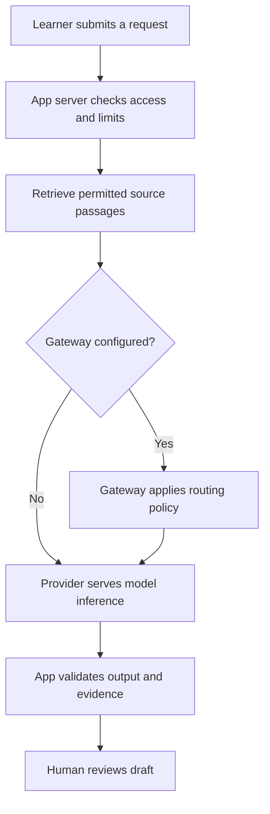

# LLMs, models, inference, and AI gateways

Reviewed: 2026-10-13. Beginner lesson; approximately 20 minutes plus optional practice.
Prerequisites: the Academy's “what-is-ai” and “privacy” lessons.
Status: educational content. This guide does not install a gateway or enable paid calls.

## What you will be able to explain

Distinguish a model from the app using it, trace an inference request, explain why a gateway is optional, and identify the quality, cost and privacy evidence needed before adoption.

## 1. Start with the vocabulary

| Term | Plain-language meaning | Example or distinction |
| --- | --- | --- |
| AI model | A computational system with learned parameters used to produce predictions or outputs | An LLM is one kind of model; other models classify images or produce embeddings |
| LLM | Large language model: trained on substantial language data to model language patterns | Can support drafting, extraction and question answering |
| Parameters / weights | Numbers learned during training | Different from the prompt supplied at runtime |
| Model family / version | Related models / a particular release or checkpoint | Record the exact version in evaluations; a family name is insufficient |
| Multimodal model | A model accepting or producing more than one modality | Text and images, for example; support varies |
| Token | A unit used to represent input or output | Often a word fragment; not reliably one word |
| Context window | The bounded amount of context supported for a request | A large limit does not guarantee accurate use of every detail |
| Provider | The organization or service serving inference | May host its own model or another developer's model |
| Application | The interface and surrounding software | Adds identity, storage, retrieval, tools and workflow |
| SDK | A programming library for calling a service | Code inside your app; distinct from a hosted gateway |

LLM fundamentals and architecture: [1]. Tokenization and text generation: [2].

## 2. Training versus inference

**Training** changes learned parameters using data and an optimization process. **Fine-tuning** performs additional training on an existing model. **Inference** runs a trained model on inputs to produce outputs. Asking a question normally performs inference; it does not immediately retrain that model. A service's separate retention or training-use policy still needs review. [1]

For a common autoregressive text model, generation repeatedly chooses a next token conditioned on the context and prior tokens. Fluent text can still be wrong. Decoding settings affect output; a low temperature is not a truth guarantee. [2]

An everyday **inference** can also mean a conclusion: “this company might need a new tool.” In model operations, **inference** means running the model. A model-generated conclusion remains a hypothesis until supported.

Retrieval-augmented generation (RAG) retrieves documents and supplies relevant material as context. It generally does not update model weights. Stored conversation history is also separate from training.

## 3. Follow one fictional request

Task: summarize an approved public vendor description into a draft with source links.

The app chooses what data leaves its boundary. The provider runs the model. The app checks the returned structure and sources. Human review is a workflow decision. These are different responsibilities.

At a deeper level, serving often includes **prefill** (processing input context) and **decode** (generating output tokens). Time to first token measures the initial delay; total latency includes the full response. Streaming shows partial output sooner without making that output verified. Hardware, context length and serving techniques influence performance. [3]

## 4. What an AI gateway does

An AI gateway is an intermediary for model requests. Depending on the product and configuration, it can centralize credentials, route requests, record usage and apply operational controls. It is not itself the underlying LLM.

Vercel documents a managed entry point across providers, with routing, observability and spend controls. [4] Cloudflare documents an AI Gateway with features including analytics, caching and rate limiting. [5] Treat these as examples, not proof that every gateway has identical behavior.

| Choice | Useful when | Tradeoff to examine |
| --- | --- | --- |
| Direct provider API | A small app uses one approved provider | App owns provider-specific integration and controls |
| Gateway | Multiple providers or shared operational policy justify it | Extra service boundary, configuration, dependency and possible fees |
| Self-hosted inference | Hosting control is required and operational capacity exists | Hardware, scaling, patching and serving costs remain |

**Provider fallback** can change who serves a model. **Model fallback** changes the model. Both require compatibility and policy checks; a successful response is not evidence of equal quality.

A gateway does not automatically supply retrieval, business authorization, factual accuracy or permission to take actions. An agent is a surrounding system that can use model outputs to select tools and repeat steps; a gateway routes model traffic within that system.

## 5. Choose the model for the task

The following is a recommended evaluation method, not a universal ranking:

1. Define the output and unacceptable failures.
2. Compare candidates on the same representative inputs.
3. Check supported modalities, output schema, context, source accuracy and abstention.
4. Measure latency, cost and human correction effort.
5. Record exact model/version, prompt, date and provider; repeat after material changes.

Embeddings produce numerical representations useful for retrieval. Rerankers reorder candidates by relevance. Generative models draft outputs. A workflow can use several types; buying access to one model does not supply the entire workflow.

Continue with [Evaluate AI models with evidence](evaluate-ai-models.md).

## 6. Read a cost estimate

**Fictional rates, not vendor pricing:** input $1 per million tokens; output $4 per million. A request with 2,000 input and 500 output tokens costs:

`2,000 / 1,000,000 × $1 + 500 / 1,000,000 × $4 = $0.004`

At 1,000 identical requests, that is $4 for those token charges alone. Add any retries, additional model calls, billable reasoning tokens, retrieval, tools, hosting or gateway charges as applicable. Cached input pricing and token accounting vary by provider.

Recommended controls: bound input/output size, concurrency, retries and agent steps; use alerts plus an enforced spending cap where supported; define behavior when the budget is exhausted. An alert alone does not stop spending. Prompt caching and returning a cached complete response are different mechanisms.

## 7. Keep the boundaries visible

A malicious instruction embedded in a retrieved page can attempt prompt injection. Treat source content as untrusted data and restrict tool permissions; a gateway alone does not solve this. [6]

For an implementation review, ask: which app, gateway and provider can see the payload? What is logged, where and for how long? Are fallback destinations approved? Does the server enforce access to retrieved records? Are secrets kept out of browsers and prompts? These are review questions, not claims about any vendor's default policy.

## 8. Practice without an API key

Use this fictional source: “Northstar Demo makes inventory software. Its public description lists retail customers.” Asked field: annual revenue. No revenue evidence is supplied.

Write a one-page request trace naming the app, optional gateway, provider, model, context and draft. Specify that revenue must remain unknown. Calculate the fictional cost above. Then diagnose:

| Event | Appropriate next step |
| --- | --- |
| Model invents revenue | Fail the evidence criterion; preserve unknown |
| Provider returns a rate-limit error | Apply a bounded retry policy; do not loop forever |
| Fallback provider has unreviewed retention | Block that route pending review |
| Gateway logs the entire source payload | Review logging and minimize/redact as appropriate |
| Valid JSON contains unsupported claims | Separate schema success from evidence failure |

**Check:** A provider is unavailable. Should you automatically switch to any available model? **Answer:** No. Use only an approved, compatible fallback with evaluated quality and cost boundaries, or return a controlled failure.

**Check:** Adding documents to the prompt retrains the model? **Answer:** No; supplied context and parameter training are different.

**Check:** Where does a tool action receive permission? **Answer:** In the application's authorization and approval flow; generated text does not grant permission.

Record progress accurately: **reviewed** = read and explained; **practiced** = completed the trace; **passed check** = answered the specific check correctly. None proves production readiness.

## Sources and next steps

Primary documentation reviewed on 2026-10-13. Product features and model catalogs change; verify again before implementation. Analogies, exercises and decision criteria above are instructional synthesis.

1. [Hugging Face — How do Transformers work?](https://huggingface.co/learn/llm-course/chapter1/4)
2. [Hugging Face Transformers — Text generation](https://huggingface.co/docs/transformers/llm_tutorial)
3. [Hugging Face Transformers — Optimizing inference](https://huggingface.co/docs/transformers/main/en/llm_optims)
4. [Vercel — AI Gateway overview](https://vercel.com/docs/ai-gateway)
5. [Cloudflare — AI Gateway overview](https://developers.cloudflare.com/ai-gateway/)
6. [OWASP — Prompt injection](https://genai.owasp.org/llmrisk/llm01-prompt-injection/)

Next: [model evaluation](evaluate-ai-models.md), [integration costs](finops-and-integration-registry.md), and the Academy's privacy and source-verification lessons.
