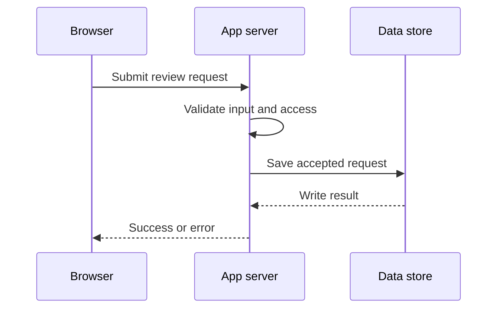

# From source code to running software

Builder Academy companion · Beginner · Fictional example

**Start with** [From idea to verified release](idea-to-verified-release.md) and [Reading Code and YAML](reading-code-and-yaml.md).  
**Goal.** Given a source file, a build output and a deployment record, explain what each one is and what you would check to know which version is running.

## Follow one change

A fictional security team uses a web app to request an alert handoff review. The form currently loses its error message when the request fails. The product requirement is to show an understandable error and keep the entered information available for a retry. Sketch the success and failure states before editing the code.

- **UI and UX.** The UI is what the user sees and operates. The UX includes how easily they can recover and finish the task. A visible, keyboard-accessible error and a clear retry path support that goal.
- **Frontend.** Browser code renders the form and sends a request. It shows pending, success and error states. See [Frontend Building Blocks](frontend-building-blocks.md).
- **Backend.** Server code receives the request, checks the input and caller’s access, writes a record when appropriate and returns a response. The frontend uses that response to update the screen.
- **Systems design.** Start by mapping the browser, server and data store. Identify where a failure can happen and who owns it. Add a queue only if the work needs to outlast the request or needs controlled retry behavior.



## What the build produces

At the computing level, bits represent values and bytes group bits. A file contains bytes interpreted according to its format. Source files are typically text in an encoding such as UTF-8. An operating system manages running processes and resources such as memory and files. The shell is one way to start a program.

| Item | Example | What happens to it |
| --- | --- | --- |
| **Source** | `ReviewForm.tsx` | A person edits it. Build tools transform it for the target runtime. |
| **Browser bundle** | A generated JavaScript file | The browser loads and executes it with its JavaScript runtime. |
| **Native executable** | A fictional Go utility built with `go build` | The operating system can start it on the target OS and CPU architecture. |
| **Build artifact** | A bundle, executable, package or release archive produced by a build | CI can retain or publish it so another step can test or deploy that version. |
| **Container image** | A versioned package with the app, required runtime files and startup configuration | A registry can store it. A container runtime uses the image to start a container. |
| **Running container** | A running instance of the image | The service executes with runtime configuration, resource limits and an isolated process environment. |

A build can produce several artifacts. Compiled code can become a native executable or bytecode depending on the toolchain. A web build can generate browser assets and server output. Use the name of the actual output when asking someone to review or deploy it.

## Where Docker, IaC and CI/CD fit

A **Dockerfile** describes steps used to build an image. An **image** packages what the workload needs to start. A **registry** stores images. A **container** is an instance created from an image. A team can run several containers from one image, and each instance may have a different lifetime or runtime configuration.

A managed platform may take source and build artifacts without asking you to write a Dockerfile. A container image is useful when you need a repeatable package that travels between compatible environments. Start with the hosting approach that fits the application and its operational needs. Multiple services or environments can justify stronger deployment coordination.

**Infrastructure as Code** describes resources such as networks, compute, storage and access configuration. Reviewing a proposed plan helps you see changes before applying them. An image packages the application. Infrastructure provides somewhere to run it.

**CI** checks the change and may produce a build artifact. **CD** moves a selected version toward an environment. A release makes behavior available to its intended users. Compare the deployed revision with the one you reviewed, then exercise the actual user flow. [First Deployment Settings](first-deployment-settings.md)

## Optional Dockerfile inspection: one deeper artifact exercise

**Status:** This is an additional **written** Docker/OCI exercise. It does not add a catalog lesson ID, Docker dependency, container runtime, deployment, cloud account, credentials or graded learner progress. No commands or builds have been executed.

Imagine a second, fictional *server API* companion to the form above. The engineer builds TypeScript `src/server.ts` into JavaScript `dist/server.js`. The latter is a **build artifact**, not necessarily a native executable. Node.js executes it. The Dockerfile below describes optional packaging of that server-side artifact:

```dockerfile
# Classroom example only: assumes dist/server.js and matching package files exist.
FROM node:22-alpine
WORKDIR /app
COPY package.json package-lock.json ./
RUN npm ci --omit=dev
COPY dist ./dist
ENV NODE_ENV=production
USER node
EXPOSE 3000
CMD ["node", "dist/server.js"]
```

**Read the file, not just its name.** `FROM` selects a base image; `COPY` imports files from the build context; `RUN` installs production dependencies; `USER` changes the runtime user; `EXPOSE` documents the intended port but does not publish a port; and `CMD` defines the default startup command. A real image must also handle a reviewed `.dockerignore`, pinned base image digest, dependencies and licenses, architecture, runtime file permissions, security scanning, health/shutdown behavior and how the app gets secrets. This illustrative Dockerfile has **not been tested as runnable** and must not be used as a production template.

Illustrative local-only commands (**not executed for this lesson**):

```sh
npm ci
npm test
npm run build
docker build -t learning/brief-api:demo .
docker image ls
docker run --rm -p 3000:3000 learning/brief-api:demo
docker ps
```

`docker build` uses the specified build context (the final `.`). A tag such as `learning/brief-api:demo` is a mutable name; an image content digest identifies exact image content. A **registry** stores/distributes an image; `docker run` creates/starts a **container** locally. Neither proves that production has that image or that the expected feature works. A Docker image is different from a VM/disk image or a PNG/JPEG visual image.

**Compare the managed route:** For a supported Next.js project, Vercel's Git-connected build/deployment process can work without a developer-owned Dockerfile. For a separate service requiring custom system packages or a specific runtime, a reviewed container package might be appropriate. Decide from workload and operational responsibility, not because Docker is fashionable. Kubernetes is an optional orchestration system, not required for this first example.

### A stop/go artifact decision

**Synthetic evidence:** The review-form PR `abc123` passed CI; a build produced `dist/server.js`; the image registry contains a tag called `demo-new`, but the test deployment still reports `demo-old`. A proposed infrastructure plan also wants to delete the notes database.

What is the next action?

- **A.** Mark the feature live because the code and image exist.
- **B.** Deploy the new tag blindly and apply the database deletion to reconcile resources.
- **C.** Stop: reconcile the target environment's deployed artifact/digest against the reviewed version, block the unexpected deletion, then verify the actual authorized/denied user flow after an approved deployment.

**Feedback:** A confuses available source/packages with deployed behavior. B changes production resources without proven requirement or permission. **C** preserves separate build, image, IaC, deployment and behavior gates. The correct answer is not an automatic approval to deploy: an authorized operator must decide, and recovery/rollback may involve data as well as code.

**Independent proof:** Explain the same distinction for a *new fictional report-export worker*, without copying the answer. Identify source, output artifact, image, running container, proposed infrastructure change and one observation that would justify a release statement. A correct multiple-choice response alone does not establish operational proficiency.

Further sources: [Docker images](https://docs.docker.com/get-started/docker-concepts/the-basics/what-is-an-image/), [Docker containers](https://docs.docker.com/get-started/docker-concepts/the-basics/what-is-a-container/), [Dockerfile overview](https://docs.docker.com/build/concepts/dockerfile/), [build context](https://docs.docker.com/build/concepts/context/), [Next.js on Vercel](https://vercel.com/docs/frameworks/full-stack/nextjs). These are conceptual references, not a substitute for verifying the exact platform/version used by an application.

## Try it on paper

A pull request fixes the form. CI reports success and publishes image digest `demo-new`. The test environment still lists `demo-old`. The digest names are fictional placeholders. Identify the source change, what CI produced, what the environment says is running and one check you would perform next.

### Check 1

Which evidence would tell you the fixed form is available in the test environment?

- **A.** The pull request has a green test check.
- **B.** The deployment record identifies the reviewed version and a walkthrough confirms that the form retains its input on failure.
- **C.** The registry contains the new image.

**Feedback.** A shows the check passed under test conditions. C shows a package exists and can be selected for deployment. B checks the deployed version and the behavior the user needs. In the exercise, verify the mismatch between the two deployment records before attributing any runtime behavior to the fix.

### Check 2

The team needs another instance of the same service. What does it start from?

- **A.** The existing reviewed image, with the appropriate runtime configuration.
- **B.** The Dockerfile as though it were a running service.
- **C.** An IaC plan as though it contained the app code.

**Feedback.** A reuses the package that can start an instance. B describes how to build that package. C describes proposed resource changes. Review capacity and configuration before adding the instance.

## Apply it independently

Pick one public-safe portfolio change. Write down the user outcome, the source changed, the artifact produced, the runtime or host, and the evidence you would inspect after release. If you can explain why each item matters and identify a missing check, you have demonstrated the reasoning for this exercise.

Continue with [First Deployment Settings](first-deployment-settings.md). Then follow these **optional, written** advanced modules in order, using the same fictional feature rather than inventing a new project:

1. [Systems design and architecture choices](systems-design-tradeoffs.md): draw the request/data boundary, compare building versus using a managed service, and document a trade-off.
2. [Infrastructure as Code plan and drift review](infrastructure-as-code-plan-review.md): distinguish application artifact from cloud resources; inspect proposed create/update/delete actions before any approved apply.
3. [Kubernetes and platform engineering](kubernetes-platform-engineering.md): compare a managed host with a container orchestration platform, diagnose an unavailable Service, and design one useful developer golden path.
4. [Observability, SLOs and incident response](observability-reliability-incidents.md): interpret service signals, investigate a failed release, and decide what real evidence confirms recovery.

**Do not treat the four links as four deployed interactive labs or an authorization to use real cloud infrastructure.** They are study companions in the draft Academy curriculum. After completing one, try its independent transfer task before moving to the next; skip Kubernetes when the workload has no orchestration need.

Sources reviewed November 6, 2026. [MDN client and server overview](https://developer.mozilla.org/en-US/docs/Learn_web_development/Extensions/Server-side/First_steps/Client-Server_overview) · [Go build and install](https://go.dev/doc/tutorial/compile-install) · [Docker overview](https://docs.docker.com/get-started/docker-overview/) · [Terraform plan](https://developer.hashicorp.com/terraform/cli/commands/plan)
