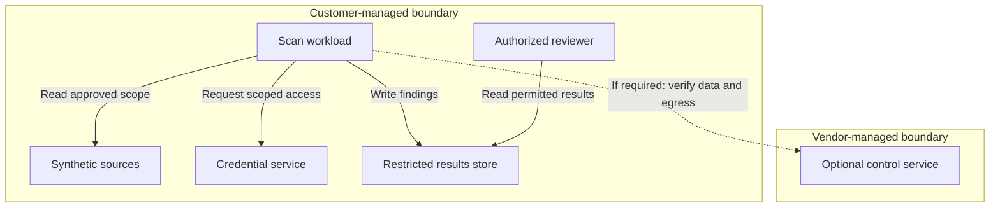
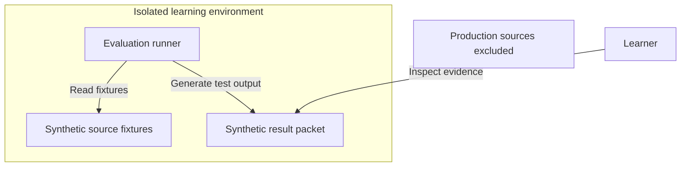

# Deployment decision and reference architecture

[Track home](README.md) · [Toolkit](toolkit.md)

**Illustrative model for fictional Sentinel Orchard. Not a supported architecture for any real product.** No ports, regions or real infrastructure identifiers are asserted.

## Decide by constraints

| Candidate pattern               | Why consider it?                           | Questions before selection                                                                      |
| ------------------------------- | ------------------------------------------ | ----------------------------------------------------------------------------------------------- |
| Vendor-managed processing       | Reduce customer workload administration    | Is this supported? What data leaves, where is it processed, and what access is granted?         |
| Customer-managed scan workload  | Place execution near restricted sources    | Who patches/scales it? What outbound access and result exports remain?                          |
| CI-based execution              | Evaluate within an existing build workflow | Are history, scheduled scans and non-code sources covered? What runtime and token limits apply? |
| Isolated evaluation environment | Bound the experiment with synthetic data   | Does the sample answer the buyer’s question? What remains untested for production?              |

Do not rank patterns before confirming support for the exact product edition. An isolated workload is not necessarily air-gapped. A CI integration is not necessarily complete historical coverage.

## Customer-managed illustrative pattern

Arrows show an initiating request or write, not every response packet. Source contents may return to the scanner; credential responses must be handled securely. The optional control service may not exist in a real deployment. Confirm all communication with current vendor documentation. This diagram is not evidence that data stays inside the customer boundary.

## Alternative isolated learning environment

Production is deliberately unconnected. This example supports safe practice but cannot establish production performance or compatibility.

## Architecture review worksheet

For each connection record: source component; destination; initiating direction; purpose; data category; authentication; required permission; network restriction; retention; owner; official reference/version; verification status. Add DNS, proxies, certificate trust, rate limits and expected workload only when supported by evidence. Never fill unknown ports or destinations by guessing.

**Production review questions:** What crosses each boundary? Who controls credentials? What happens during an outage? Where are logs and findings stored? Who can access them? What changes between evaluation and production? How is access revoked? Which deployment assumption would invalidate this recommendation?

## Source and limit

[NIST SP 800-161 Rev. 1](https://csrc.nist.gov/pubs/sp/800/161/r1/upd1/final) provides supply-chain risk-management context. These diagrams and decision questions are original educational synthesis, not NIST-approved designs. A product-specific version needs an SA/engineering review and current official product sources.
